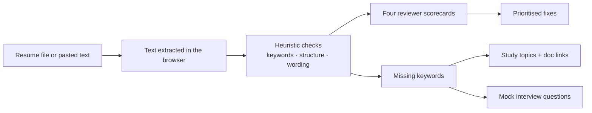

<div align="center">



### Walk your resume through the hiring process 🌿

[](https://vishalkashyap01.github.io/ResumeRooms/)
[](#-privacy--honesty)
[](#-how-it-works-behind-the-scenes)

**[🌱 Open the app →](https://vishalkashyap01.github.io/ResumeRooms/)**

</div>


## 🌱 What is ResumeRooms?

Upload your resume once. A recruiter, a tech manager, HR and an ATS each score it from their own point of view. Then walk into three more rooms: prioritised fixes, a study plan built from your gaps, and a mock interview in the office of the company you are targeting.

Everything runs in your browser. Nothing is uploaded.



## 🚪 The four rooms

| Room | What you do | What you get |
|---|---|---|
| **1 · ATS Lab** | Pick a target role, optionally paste a job description, then drop a PDF, DOCX or TXT (or paste the text) | A scorecard from four separate reviewers |
| **2 · Suggestion Room** | Read your scan results | Prioritised fixes for contact details, keywords, structure, wording and STAR impact |
| **3 · Study Room** | Follow the topic list | Topics drawn from the keywords your resume is missing (or the role's core list), with official docs and a YouTube search for each |
| **4 · Mock Test Room** | Choose a company office and start | Questions mixing resume deep-dives, technical, behavioural and company-style themes |

Every room has its own anchor (`#r1` to `#r4`), so you can deep-link straight to one.

## 👀 Four reviewers, four lenses

A recruiter, a hiring manager, HR and an ATS each look for different things, so ResumeRooms scores them separately.

| Reviewer | Typically cares about |
|---|---|
| Recruiter | A fast scan: clear role fit, relevant titles, easy-to-read layout |
| Tech manager | Skill depth, projects, evidence of impact |
| HR | Completeness, consistency, professional presentation |
| ATS | Parseable structure, standard sections, keyword match |

## ✍️ The STAR bullet pattern

Illustrative example, not real data:

| | |
|---|---|
| **Before** | Responsible for sales reports. |
| **After** | Built a weekly Power BI sales dashboard (Action) for a 12-person team (Situation/Task), cutting reporting time by 40% (Result). |

Formula: **strong verb + what you did + tool + measurable result.** Only claim numbers you can defend in an interview.

## 🔒 Privacy & honesty

- **In-browser only.** Your resume text stays on your device.
- **Heuristic scores.** Scores come from keyword, structure and wording checks. This is *not* a real vendor ATS, and every ATS parses differently.
- **Original questions.** The mock questions are written around commonly discussed themes. They are not scraped from Glassdoor or Reddit.

## ⚙️ How it works behind the scenes



<!-- Confirm this diagram and list the exact libraries used for PDF/DOCX parsing before publishing. -->

A static front end with no server and no database: the page does the parsing, scoring and question selection itself, which is why nothing needs to be uploaded.

## 🌍 Nature-friendly by design

- **Light footprint.** A static site on GitHub Pages needs no always-on server.
- **No uploads.** Your data never travels, so there is nothing to store or clean up.
- **Calm palette and gentle motion.** Greens, sky and sunlight, with subtle animation only.

## 🚀 Run it locally

```bash
git clone https://github.com/vishalkashyap01/ResumeRooms.git
cd ResumeRooms
python -m http.server 8000
# then open http://localhost:8000
```

## 🗺️ Ideas for next

- [ ] Add links to real candidate interview reports in the Mock Test Room
- [ ] Export the scorecard and fixes as a PDF
- [ ] More target roles and company offices
- [ ] Compare two resume versions side by side

## 🤝 Contributing

Issues and pull requests are welcome. For bigger changes, open an issue first so we can talk it through.


<div align="center">

**Made by VISHAL with LOVE** 🌿

⭐ If ResumeRooms helped you, plant a star on the repo.

</div>
